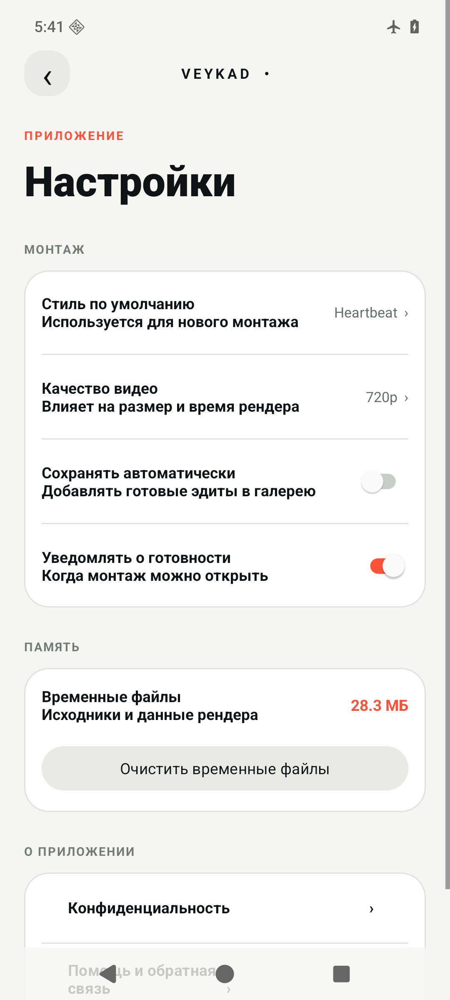
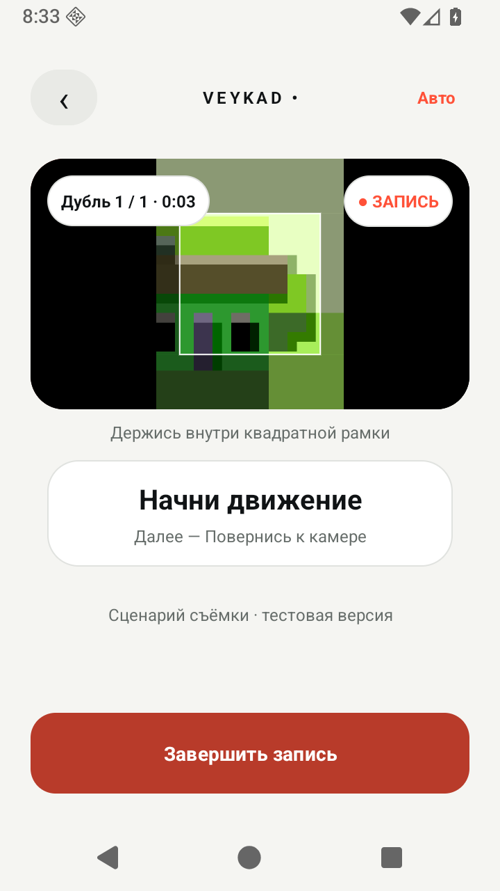

# Veycad

## Права и условия использования

Copyright (c) 2026 Leonid Polyakov <whiteking.power12@gmail.com>.
**All rights reserved — все права защищены.**

Публичный доступ к репозиторию не предоставляет открытую лицензию.
Использование, копирование, изменение, распространение, сублицензирование
и продажа авторского кода и других авторских материалов проекта — в коммерческих
или некоммерческих целях — требуют предварительного письменного разрешения
Leonid Polyakov, кроме случаев, предусмотренных применимым законодательством
или прямо разрешённых условиями GitHub. Возможность просмотра и создания
форков по условиям GitHub сохраняется.

Сторонние библиотеки, модели, музыка и другие материалы сохраняют собственные
лицензии и права их владельцев. Полные условия — в [LICENSE](LICENSE).
Запросить разрешение: [whiteking.power12@gmail.com](mailto:whiteking.power12@gmail.com).

**Твои видео. Готовый монтаж.**

Veycad — Android-приложение для автоматического монтажа коротких видео под музыку
и создания субтитров. Выберите исходники и стиль: приложение проанализирует материал,
соберёт монтаж и создаст MP4, который можно посмотреть, сохранить или отправить.
Обработка выполняется на телефоне, без аккаунта и отправки видео в облако.

> Проект находится в разработке. Публичного релиза в GitHub Releases пока нет.

## Что умеет приложение

- **Монтировать видео из галереи.** Выбирать моменты и собирать их под ритм
  встроенной музыки в стилях Heartbeat, FEAR и DUALITY.
- **Добавлять текст и субтитры.** Заголовки, плашки, оформление и локальное
  распознавание русской и английской речи через Whisper. Текст и время фраз
  можно исправлять перед экспортом.
- **Снимать с подсказками в режиме «Авто».** Экспериментальный путь для Heartbeat
  и FEAR: подготовка, запись, просмотр и подбор дубля для монтажа.
- **Сохранять результат.** Просмотр MP4, локальная коллекция, сохранение в галерею
  и отправка через системное меню Android.

| Стиль | Исходники | Характер монтажа | Доступность |
| --- | --- | --- | --- |
| Heartbeat | Одно видео от 15 секунд | Пульс, эхо и повтор музыкальной фразы | Доступен |
| FEAR | Одно видео от 15 секунд | Движение, резкие склейки и строб-акценты | Доступен |
| DUALITY | Два видео, каждое от 6 секунд | Перекличка двух сцен | Доступен |
| Сигма | — | Работа над стилем приостановлена | Временно недоступен |

Результат зависит от исходного материала. Если надёжных признаков человека,
движения или подходящих моментов недостаточно, приложение может предложить другой
материал. Распознанные субтитры требуют проверки пользователем.

## Как пользоваться

1. Добавьте одно или два видео из галереи и выберите доступный стиль.
2. Запустите монтаж и дождитесь анализа и экспорта.
3. Посмотрите результат, сохраните его в галерею или отправьте.
4. При необходимости откройте «Добавить текст»: заголовки и субтитры экспортируются
   в новый MP4 со звуком выбранного файла.

Для съёмки с подсказками выберите «Создать» → «Авто». Подробнее о текущих
возможностях и незавершённых проверках — в [описании режима «Авто»](docs/plans/auto-camera-implementation-status.md).

<details>
<summary>Примеры экранов из предыдущих сборок</summary>

<p>
  
  
</p>

Настройки показаны на раннем снимке интерфейса, запись — в тестовой сборке 0.1.12
на эмуляторе с синтетическим изображением камеры. Текущий интерфейс может
отличаться. Скриншоты иллюстрируют экраны, а не качество готового монтажа.

</details>

## Как попробовать

Пока приложение можно собрать из исходников по инструкции ниже.
[Раздел Releases](https://github.com/Veycad/Veycad/releases) предназначен
для будущих опубликованных сборок; локальные APK из отчётов не являются релизами.

Минимальная версия Android в APK — **8.0 / API 26**. Наличие поддержки установки
не означает проверенный полный экспорт на каждом устройстве. Базовый формат
материала — MP4 с H.264/AVC и SDR; совместимость других кодеков зависит от телефона.
Подробные требования и ограничения: [матрица устройств и видео](docs/SupportMatrix.md).

## Текущее состояние

В `app/build.gradle.kts` на момент обновления README указана версия **0.1.16**
(`versionCode = 17`). Это версия исходников, а не заявление о готовности релиза.

- Основной пользовательский путь сохраняет готовый MP4. Ядро редактируемого
  проекта, история ревизий и подготовка предпросмотра присутствуют в коде;
  их сквозное подключение к основному экрану ещё не завершено.
- Для отдельных монтажных сборок сохранены нативные экспорты и протоколы проверок.
  Полная приёмка актуального релиза на разнообразных материалах и физических
  устройствах остаётся открытой.
- Режим «Авто» требует дальнейшей проверки живой съёмки, синхронизации музыки
  и готовых монтажей на физических устройствах.
- Верхний предел длительности входа и бюджет анализа ещё не реализованы.
  Неограниченная обработка длинных видео не гарантируется; HDR не входит
  в подтверждённый базовый формат.

Задачи: [todo.md](todo.md). Доказательства и границы проверок:
[каталог качества](docs/quality/README.md), [текст и субтитры](docs/testing/text-subtitles.md),
[приёмка режима «Авто»](docs/testing/auto-camera-device-review.md).
Подробная история старых сборок перенесена в [архив статуса README](docs/quality/readme-status-archive-2026-10-15.md).

## Разработчикам

Проект содержит одно Android-приложение в модуле `app`. Основной монтажный путь:

```text
MainActivity → EditSession → VeycadAutomaticEditor
  → анализ видео и музыки → режиссёр стиля → MontageGraph
  → HighQualityFramePlan → MediaCodec / GLES → AAC mux
  → проверка готового MP4 → CompletedRenderStore
```

`MontageGraph` описывает монтаж, `HighQualityFramePlan` задаёт расписание кадров,
а renderer исполняет его. `HybridProjectStore` и `HybridProjectCodec` отвечают
за сохраняемые редактируемые проекты. Текстовый сценарий использует
`TextEditSession` и тот же видеорендерер. ML Kit и MediaPipe работают локально;
MediaPipe изолирован в процессе `:matte_engine`.

### Сборка и проверки

Нужны JDK 25, Android SDK Platform 36, Build-Tools 36.0.0, NDK 28.2.13676358,
CMake 3.22.1 и Python 3.12. Gradle 9.3.1 и Android Gradle Plugin 9.1.1 закреплены
в проекте. Путь к SDK задаётся в игнорируемом `local.properties` или `ANDROID_HOME`.

При первой сборке нужны сеть для зависимостей, модели Whisper base (примерно
148 МБ) и исходников закреплённой версии whisper.cpp. Проверенная модель входит
в APK; приложение не скачивает её во время работы. Версии, SHA-256 и лицензии
закреплены в `app/build.gradle.kts` и `app/src/main/cpp/CMakeLists.txt`.

Пример для PowerShell из корня репозитория:

```powershell
$env:JAVA_HOME = 'C:\Program Files\Android\Android Studio\jbr'
$env:Path = "$env:JAVA_HOME\bin;$env:Path"
python -m pip install -r tools/requirements-test.txt
.\gradlew.bat :app:assembleDebug
.\gradlew.bat baselineVerify -PpythonExecutable=python
```

`baselineVerify` запускает Android unit-тесты, Python-тесты инструментов, lint,
проверку release manifest и сборку debug APK. Пустые или пропущенные тесты
считаются ошибкой. Проверки UI запускаются отдельно; в автоматических тестах
основного монтажного сценария тяжёлый движок заменён управляемым тестовым
исполнителем. Сборка и CI не заменяют проверку экспортированного MP4 и просмотр
результата на устройстве.

- [Настройка Windows и сборка](WINDOWS.md)
- [UI-тесты и границы их покрытия](docs/testing/ui-tests.md)
- [Ревью тестов и mutation-проверки](docs/testing/test-review.md)
- [Документация событийного конвейера](docs/EventDrivenEngine.md)
- [Контракт хранения и подготовки редактируемого проекта](docs/integration/hybrid-mvp-prepared-handoff.md)
- [Правила участия и публикации через PR](CONTRIBUTING.md)
- [Локальная обработка и безопасность](docs/Security.md)

Пользовательские видео и локальные golden MP4 не входят в Git и APK.
